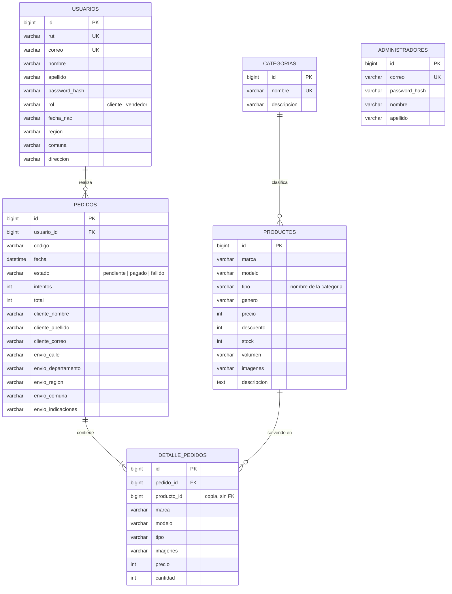

# Modelo de datos — Perfumes Store

Base de datos **MySQL 8** (`tienda_perfumes`). Las tablas se generan desde las entidades JPA del paquete `model/` con `spring.jpa.hibernate.ddl-auto=update`, y el catálogo inicial se carga desde `catalogo_inicial_perfumes.sql`.

---

## 1. Relación con el modelo propuesto en la pauta

La pauta propone cinco tablas. Así quedaron implementadas:

| Tabla de la pauta | Tabla en MySQL | Entidad Java | Comentario |
|---|---|---|---|
| `USUARIO` | `usuarios` | `Usuario` | Clientes y vendedores (columna `rol`) |
| `USUARIO` (admin) | `administradores` | `Administrador` | El administrador se guarda aparte; no tiene registro público |
| `BOLETA` | `pedidos` | `Pedido` | Cabecera de la compra: cliente, envío, total y estado |
| `DETALLE_BOLETA` | `detalle_pedidos` | `DetallePedido` | Una fila por cada perfume comprado |
| `PRODUCTO` | `productos` | `Producto` | Catálogo de perfumes |
| `CATEGORIA` | `categorias` | `Categoria` | árabe, nicho, diseñador, etc. |

```
Pauta:   USUARIO - - -> BOLETA ----> DETALLE_BOLETA <---- PRODUCTO <---- CATEGORIA
MySQL:   usuarios - - -> pedidos ---> detalle_pedidos <--- productos <--- categorias
```

---

## 2. Diagrama entidad-relación



> El diagrama se ve como imagen directamente en GitHub. `ADMINISTRADORES` no tiene relaciones: solo se usa para el login del administrador.

---

## 3. Relaciones

| Relación | Cardinalidad | Cómo se implementa | Por qué |
|---|---|---|---|
| `usuarios` → `pedidos` | 1 a N (opcional) | **Llave foránea** `pedidos.usuario_id` → `usuarios.id` (`@ManyToOne`) | Cada pedido pertenece a un cliente. Es opcional, igual que la línea punteada de la pauta |
| `pedidos` → `detalle_pedidos` | 1 a N | **Llave foránea** `detalle_pedidos.pedido_id` → `pedidos.id` (`@OneToMany`, `cascade = ALL`, `orphanRemoval = true`) | El detalle se guarda y borra junto con su pedido |
| `productos` → `detalle_pedidos` | 1 a N | Columna `detalle_pedidos.producto_id` **sin llave foránea**, más una **copia** de marca, modelo, tipo, imagen y precio | Es un **registro histórico**: la boleta debe seguir mostrando lo que se vendió aunque el producto cambie de precio o se elimine |
| `categorias` → `productos` | 1 a N | Por **nombre**: `productos.tipo` = `categorias.nombre` | Así lo usa el frontend desde la Evaluación 2. La integridad la cuida `CategoriaService`: no se repiten nombres, no se borra una categoría con productos y, al renombrarla, se actualizan sus productos |

---

## 4. Diccionario de datos

### `usuarios`
| Columna | Tipo | Nulo | Clave | Descripción |
|---|---|:-:|:-:|---|
| `id` | BIGINT | No | PK | Identificador autoincremental |
| `rut` | VARCHAR(255) | No | UNIQUE | RUN sin puntos ni guion, validado con módulo 11 |
| `correo` | VARCHAR(255) | No | UNIQUE | Se guarda en minúsculas |
| `nombre` | VARCHAR(255) | Sí | | |
| `apellido` | VARCHAR(255) | Sí | | |
| `password_hash` | VARCHAR(255) | No | | Contraseña cifrada con **BCrypt** (nunca en texto plano) |
| `rol` | VARCHAR(255) | Sí | | `cliente` o `vendedor` |
| `fecha_nac` | VARCHAR(255) | Sí | | Formato `AAAA-MM-DD` |
| `region` | VARCHAR(255) | Sí | | |
| `comuna` | VARCHAR(255) | Sí | | |
| `direccion` | VARCHAR(255) | Sí | | |

### `administradores`
| Columna | Tipo | Nulo | Clave | Descripción |
|---|---|:-:|:-:|---|
| `id` | BIGINT | No | PK | |
| `correo` | VARCHAR(255) | No | UNIQUE | Cuenta inicial: `admin@duoc.cl` |
| `password_hash` | VARCHAR(255) | No | | BCrypt |
| `nombre` | VARCHAR(50) | Sí | | |
| `apellido` | VARCHAR(100) | Sí | | |

### `pedidos` (BOLETA)
| Columna | Tipo | Nulo | Clave | Descripción |
|---|---|:-:|:-:|---|
| `id` | BIGINT | No | PK | Número de pedido |
| `usuario_id` | BIGINT | Sí | FK → `usuarios.id` | Cliente que compró |
| `codigo` | VARCHAR(255) | Sí | | Código visible, ej. `ORDER784A3B4071` |
| `fecha` | DATETIME(6) | Sí | | Fecha y hora de la compra |
| `estado` | VARCHAR(255) | Sí | | `pendiente`, `pagado` o `fallido` |
| `intentos` | INT | Sí | | Intentos de pago realizados |
| `total` | INT | Sí | | Total en pesos, calculado por el backend |
| `cliente_nombre` | VARCHAR(50) | Sí | | Datos del comprador al momento de la compra |
| `cliente_apellido` | VARCHAR(100) | Sí | | |
| `cliente_correo` | VARCHAR(100) | Sí | | |
| `envio_calle` | VARCHAR(300) | Sí | | Dirección de despacho |
| `envio_departamento` | VARCHAR(20) | Sí | | |
| `envio_region` | VARCHAR(100) | Sí | | |
| `envio_comuna` | VARCHAR(100) | Sí | | |
| `envio_indicaciones` | VARCHAR(300) | Sí | | |

### `detalle_pedidos` (DETALLE_BOLETA)
| Columna | Tipo | Nulo | Clave | Descripción |
|---|---|:-:|:-:|---|
| `id` | BIGINT | No | PK | |
| `pedido_id` | BIGINT | No | FK → `pedidos.id` | Boleta a la que pertenece |
| `producto_id` | BIGINT | Sí | | ID del perfume vendido (referencia histórica) |
| `marca` | VARCHAR(255) | Sí | | Copia al momento de la compra |
| `modelo` | VARCHAR(255) | Sí | | Copia |
| `tipo` | VARCHAR(100) | Sí | | Categoría al momento de la compra |
| `imagenes` | VARCHAR(1000) | Sí | | Copia |
| `precio` | INT | Sí | | **Precio unitario final** (con el descuento ya aplicado) |
| `cantidad` | INT | Sí | | Unidades compradas |

### `productos` (PRODUCTO)
| Columna | Tipo | Nulo | Clave | Descripción |
|---|---|:-:|:-:|---|
| `id` | BIGINT | No | PK | |
| `marca` | VARCHAR(255) | Sí | | |
| `modelo` | VARCHAR(255) | Sí | | |
| `tipo` | VARCHAR(255) | Sí | | Nombre de la categoría |
| `genero` | VARCHAR(255) | Sí | | `hombre`, `mujer` o `unisex` |
| `precio` | INT | Sí | | Precio normal en pesos |
| `descuento` | INT | Sí | | Porcentaje de 0 a 90 |
| `stock` | INT | Sí | | Unidades disponibles (crítico: 5 o menos) |
| `volumen` | VARCHAR(255) | Sí | | Ej. `100 ml` |
| `imagenes` | VARCHAR(1000) | Sí | | Ruta de la foto |
| `descripcion` | TEXT | Sí | | |

### `categorias` (CATEGORIA)
| Columna | Tipo | Nulo | Clave | Descripción |
|---|---|:-:|:-:|---|
| `id` | BIGINT | No | PK | |
| `nombre` | VARCHAR(255) | No | UNIQUE | Ej. `arabe`, `nicho`, `diseñador` |
| `descripcion` | VARCHAR(500) | Sí | | |

> Las columnas aparecen como "Nulo: Sí" porque así las crea Hibernate. Los datos obligatorios se validan antes de guardar, con los DTO (`@NotBlank`, `@NotNull`, etc.) y en los servicios.

---

## 5. Reglas de negocio que protegen los datos

| Regla | Dónde se aplica |
|---|---|
| El total del pedido lo calcula el backend con el precio y el descuento de MySQL | `PedidoService.crearPedido` |
| No se vende más que el stock disponible | `PedidoService.crearPedido` y `procesarPago` |
| El stock se descuenta solo cuando el pago se aprueba | `PedidoService.procesarPago` |
| Un pedido pagado no se puede pagar otra vez | `PedidoService.procesarPago` |
| Correo y RUN únicos | `UsuarioService` + restricción `UNIQUE` en MySQL |
| No se elimina un usuario con pedidos | `UsuarioService.eliminarUsuario` |
| No se repiten categorías ni se borra una con productos | `CategoriaService` |
| Contraseñas cifradas con BCrypt | `UsuarioService` y `AdministradorService` |

---

## 6. Consultas de ejemplo

```sql
-- Boletas con su detalle
SELECT p.id, p.codigo, p.estado, p.total, d.marca, d.modelo, d.cantidad, d.precio
FROM pedidos p
JOIN detalle_pedidos d ON d.pedido_id = p.id
ORDER BY p.id;

-- Productos por categoría
SELECT c.nombre AS categoria, COUNT(pr.id) AS productos
FROM categorias c
LEFT JOIN productos pr ON pr.tipo = c.nombre
GROUP BY c.nombre;

-- Ventas pagadas por cliente
SELECT u.correo, COUNT(p.id) AS compras, SUM(p.total) AS total_comprado
FROM usuarios u
JOIN pedidos p ON p.usuario_id = u.id
WHERE p.estado = 'pagado'
GROUP BY u.correo;
```
