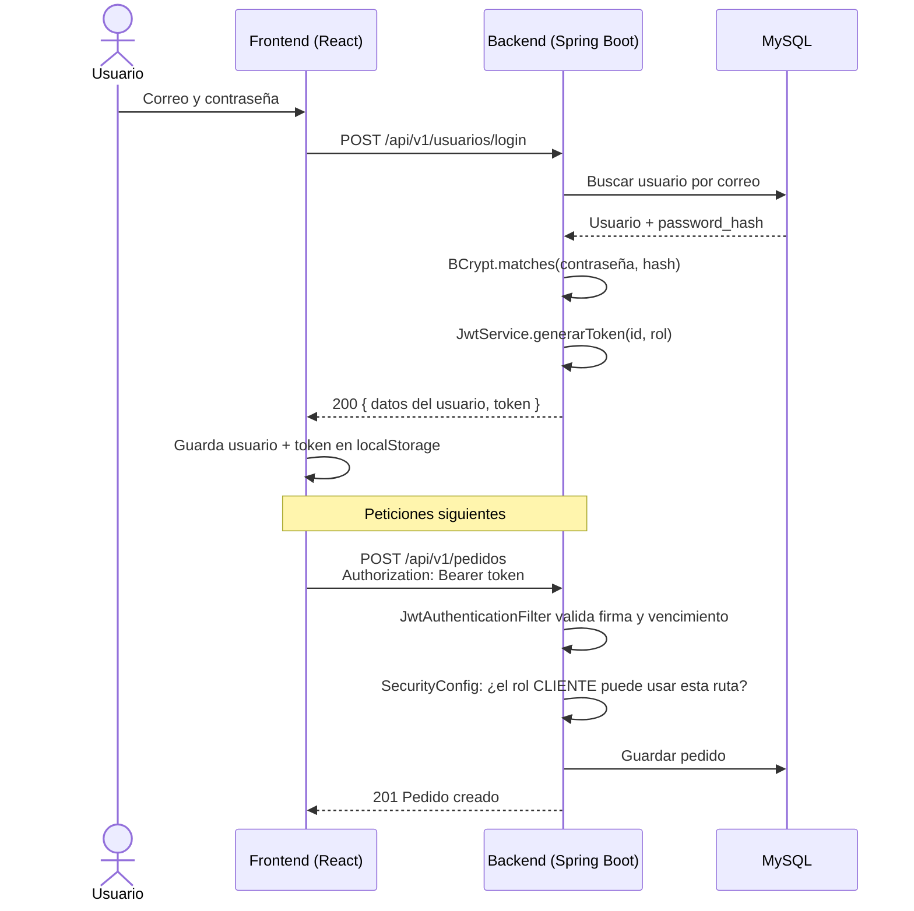

# Seguridad: autenticación JWT y autorización por roles

Este documento explica cómo el backend de **Perfumes Store** cumple los requisitos de seguridad de la pauta:

- ✅ Configurar **Spring Security** para la autenticación de usuarios mediante **roles**.
- ✅ Implementar **JWT** para la autenticación basada en tokens.
- ✅ **Restringir el acceso** a funciones específicas según los permisos del usuario.

---

## 1. Componentes

| Archivo | Responsabilidad |
|---|---|
| `security/JwtService.java` | Crea y valida los tokens (firma **HS384** con clave secreta, emisor y vencimiento) |
| `security/JwtAuthenticationFilter.java` | Filtro que se ejecuta en **cada petición**: lee el token, lo valida y registra el usuario y su rol |
| `config/SecurityConfig.java` | Define qué rol puede usar cada ruta, desactiva las sesiones y configura las respuestas 401/403 y CORS |
| `controller/UsuarioController.java` | Login de clientes y vendedores: devuelve el token |
| `controller/AdministradorController.java` | Login del administrador: devuelve el token |
| `service/UsuarioService.java` / `AdministradorService.java` | Verifican la contraseña con **BCrypt** |
| `@PreAuthorize` en `PedidoController` | Segunda capa de control a nivel de método |

---

## 2. ¿Qué es el token JWT?

Un JWT tiene tres partes separadas por puntos: `header.payload.firma`. El header indica el algoritmo: `{"alg": "HS384"}`.

```
eyJhbGciOiJIUzM4NCJ9 . eyJzdWIiOiIzIiwicm9sIjoiQ0xJRU5URSIs... . Xk2v9...
       header                       payload                        firma
```

**Payload de un cliente** (decodificado):
```json
{
  "correo": "ana@duoc.cl",
  "sub": "3",
  "rol": "CLIENTE",
  "iss": "perfumes-store",
  "iat": 1795278790,
  "exp": 1795285990
}
```

| Dato | Significado |
|---|---|
| `sub` | Quién es: el **ID** del cliente o vendedor, o el **correo** del administrador |
| `rol` | `ADMIN`, `VENDEDOR` o `CLIENTE` |
| `iss` | Emisor: `perfumes-store`. Se rechazan tokens de otro emisor |
| `iat` / `exp` | Cuándo se creó y cuándo vence (**120 minutos** después) |

**La firma es lo que lo hace seguro.** Se calcula con el algoritmo **HS384** (HMAC con SHA-384; JJWT lo elige según el largo de la clave) y una clave secreta que solo conoce el backend (`app.jwt.secret`). Si alguien modifica el payload (por ejemplo, cambia `"rol": "CLIENTE"` por `"ADMIN"`), la firma deja de coincidir y el backend responde **401**. Esto está probado en `JwtServiceTest.rechazaTokenModificado` y se verificó manualmente contra la API.

> El payload **no está cifrado**, solo firmado: cualquiera puede leerlo. Por eso nunca lleva contraseñas ni datos sensibles.

---

## 3. Flujo de autenticación



### Qué hace `JwtAuthenticationFilter` en cada petición

1. Busca el encabezado `Authorization: Bearer <token>`.
2. Si no hay token, la petición sigue como **anónima**.
3. Si hay token, `JwtService.validar()` comprueba la **firma**, el **emisor** y el **vencimiento**.
4. Si es válido, registra en Spring Security al usuario (`sub`) con la autoridad `ROLE_<rol>` (ej. `ROLE_CLIENTE`).
5. Si es inválido, marca la petición para responder: *"Tu sesión expiró o el token no es válido"*.
6. Después, `SecurityConfig` decide si la ruta se permite para ese rol.

### Sin sesiones en el servidor

```java
.sessionManagement(sesion -> sesion.sessionCreationPolicy(SessionCreationPolicy.STATELESS))
```

El servidor **no guarda quién inició sesión**: todo lo necesario viene dentro del token. Por eso:
- Cerrar sesión = el frontend borra el token (los endpoints `/logout` solo lo confirman).
- No se usan cookies de sesión, así que la protección CSRF no aplica y está desactivada.

---

## 4. Roles y permisos

| Rol | Dónde se guarda | Cómo se crea | Qué puede hacer |
|---|---|---|---|
| **ADMIN** | Tabla `administradores` | Al iniciar el backend (`ADMIN_EMAIL` / `ADMIN_PASSWORD`) | **Acceso total** |
| **VENDEDOR** | Tabla `usuarios`, `rol = 'vendedor'` | El admin, desde el panel | Ver la lista y el detalle de **productos** y de **órdenes** |
| **CLIENTE** | Tabla `usuarios`, `rol = 'cliente'` | Registro público en la tienda | Solo la **tienda**: comprar y pagar sus propios pedidos |

### Matriz de permisos

| Recurso | Sin sesión | CLIENTE | VENDEDOR | ADMIN |
|---|:-:|:-:|:-:|:-:|
| Ver catálogo (productos, categorías, imágenes) | ✅ | ✅ | ✅ | ✅ |
| Registrarse e iniciar sesión | ✅ | ✅ | ✅ | ✅ |
| Comprar y pagar | 401 | ✅ (solo lo propio) | 403 | 403 |
| Ver órdenes (listado y detalle) | 401 | 403 | ✅ | ✅ |
| Crear, editar o borrar productos y subir imágenes | 401 | 403 | 403 | ✅ |
| Crear, editar o borrar categorías | 401 | 403 | 403 | ✅ |
| Gestionar usuarios y ver el total de clientes | 401 | 403 | 403 | ✅ |
| Ver y editar el perfil de administrador | 401 | 403 | 403 | ✅ |

### Cómo se aplica en `SecurityConfig`

```java
// Pedidos: el ADMIN y el VENDEDOR pueden ver el listado y el detalle
.requestMatchers(HttpMethod.GET, API + "/pedidos/**").hasAnyRole("ADMIN", "VENDEDOR")

// Gestión de productos (incluye subir imágenes)
.requestMatchers(HttpMethod.POST, API + "/productos/**").hasRole("ADMIN")
.requestMatchers(HttpMethod.PUT, API + "/productos/**").hasRole("ADMIN")
.requestMatchers(HttpMethod.DELETE, API + "/productos/**").hasRole("ADMIN")

// Compras: solo clientes autenticados
.requestMatchers(HttpMethod.POST, API + "/pedidos").hasRole("CLIENTE")

// Catálogo público
.requestMatchers(HttpMethod.GET, API + "/**").permitAll()

// Cualquier otra ruta de la API requiere iniciar sesión
.requestMatchers(API + "/**").authenticated()
```

### Segunda capa: `@PreAuthorize`

`@EnableMethodSecurity` activa anotaciones en los métodos de los controladores. Aunque alguien cambiara por error una regla de `SecurityConfig`, el método igual verifica el rol:

```java
@PreAuthorize("hasAnyRole('ADMIN', 'VENDEDOR')")
@GetMapping("/{id}")
public Map<String, Object> obtenerDetalle(@PathVariable Long id) { ... }
```

### Tercera capa: reglas de negocio
Además del rol, los servicios comprueban que **el recurso sea del usuario**:
- Un cliente no puede crear un pedido a nombre de otro (`usuarioId` debe ser el mismo `sub` del token).
- Un cliente no puede pagar el pedido de otro cliente.
- Desde el panel no se puede crear a otro administrador: solo los roles `cliente` y `vendedor`.

---

## 5. Contraseñas

- Se guardan con **BCrypt** (`$2a$10$...`): un hash con "sal" aleatoria, así que dos contraseñas iguales producen hashes distintos.
- Nunca se devuelven en la API (`@JsonIgnore` en `passwordHash`).
- El mensaje de un login fallido es siempre el mismo (*"Correo o contraseña incorrectos."*), para no revelar si el correo existe.

---

## 6. Respuestas 401 y 403

| Código | Cuándo | Mensaje |
|---|---|---|
| **401** | No se envió token | `Debes iniciar sesión para acceder a este recurso.` |
| **401** | Token vencido, alterado o mal formado | `Tu sesión expiró o el token no es válido. Inicia sesión nuevamente.` |
| **403** | Token válido, pero el rol no tiene permiso | `No tienes permisos para realizar esta acción.` |

Cuando el frontend recibe un **401** teniendo un token guardado, borra la sesión y lleva al usuario al login (ver [`INTEGRACION.md`](INTEGRACION.md)).

---

## 7. CORS

`SecurityConfig.corsConfigurationSource()` permite llamadas desde el frontend de Vite (`http://localhost:5173`), con los encabezados `Authorization` y `Content-Type`. Los orígenes se configuran en `app.cors.origenes`.

---

## 8. Configuración

| Propiedad | Valor por defecto | Descripción |
|---|---|---|
| `app.jwt.secret` | `${JWT_SECRET:clave-de-desarrollo-...}` | Clave para firmar (mínimo 32 caracteres) |
| `app.jwt.expiracion-minutos` | `120` | Duración del token |
| `app.cors.origenes` | `http://localhost:5173,http://127.0.0.1:5173` | Orígenes permitidos |

> ⚠️ La clave por defecto es solo para desarrollo. En producción se debe definir la variable de entorno `JWT_SECRET` y no subirla al repositorio.

---

## 9. Cómo se verificó

| Prueba | Resultado |
|---|---|
| `SeguridadApiIntegrationTest` (12 pruebas): matriz de permisos completa con MockMvc | ✅ Todas pasan |
| `JwtServiceTest` (6 pruebas): token válido, modificado, de otra clave, vencido, texto cualquiera, clave corta | ✅ Todas pasan |
| Prueba manual: un cliente cambia su rol a `ADMIN` dentro del token | ✅ Rechazado con 401 |
| Prueba en el navegador: el vendedor solo ve Órdenes y Productos en el panel | ✅ |

Ver [`PRUEBAS.md`](PRUEBAS.md).
